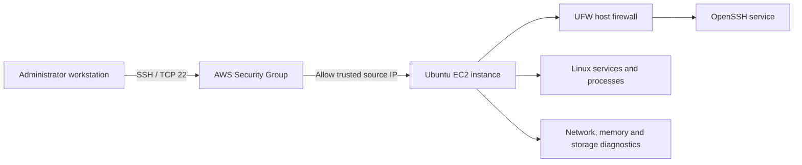

# Linux Home Lab Ubuntu on AWS EC2

A hands-on Linux operations lab built to practise secure remote administration, host firewall configuration, service management, system inspection, and evidence-based troubleshooting on an Ubuntu EC2 instance.

## What this project demonstrates

- Connecting to an Ubuntu server using SSH key-based authentication.
- Understanding the two network access layers: an AWS Security Group and the host-level UFW firewall.
- Checking Linux users, processes, services, logs, storage, memory, network interfaces, routes, and DNS.
- Following a repeatable troubleshooting process: establish a baseline, gather evidence, isolate the cause, make one change, and verify recovery.
- Keeping a command reference with **40+ commands personally executed**, including observations from the actual lab environment.

## Architecture



The AWS Security Group filters traffic at the cloud network boundary. UFW adds host-level firewall rules inside Ubuntu. Both layers must permit SSH for a connection to work.

## Technology stack

| Technology | Role in the lab |
|---|---|
| AWS EC2 | Hosts the Linux instance |
| Ubuntu Server | Operating system under test |
| OpenSSH | Secure remote administration |
| EC2 key pair | SSH key-based authentication |
| AWS Security Groups | Cloud-level network access control |
| UFW | Host-level firewall management |
| systemd | Service and system-state inspection |
| Bash and standard Linux tools | Administration and diagnostics |
| Git and GitHub | Version control and public documentation |

## Repository layout

```text
linux-home-lab/
├── README.md
├── .gitignore
├── notes/
│   ├── linux-command-cheatsheet.md
│   ├── ssh-setup.md
│   ├── troubleshooting.md
│   └── ufw-firewall.md
├── screenshots/
│   ├── ec2-ubuntu.png
│   ├── ssh-service.png
│   ├── ufw-firewall.png
│   ├── command-lab.png          # capture after running the command suite
│   └── troubleshooting.png      # capture after the recovery test
└── scripts/
    └── cleanup.sh
```

The last two screenshots are planned evidence files. Add them after capturing the actual terminal output; do not create illustrative screenshots or substitute expected output for real results.

## Prerequisites

- An Ubuntu EC2 instance that passes its AWS status checks.
- The matching EC2 private key available on the administrator workstation.
- SSH (TCP port 22) allowed in the instance's Security Group **only from a trusted source IP**.
- A Linux user with `sudo` privileges.
- Network access for package installation and any external connectivity tests.

Use placeholders in documentation. Do not publish private keys, passwords, access tokens, AWS account IDs, or unnecessary network details.

## Setup runbook

### 1. Connect to the instance

On the administrator workstation, restrict the private key's file permissions and connect using the correct key and public address:

```bash
chmod 400 "$HOME/.ssh/<ec2-private-key>.pem"
ssh -i "$HOME/.ssh/<ec2-private-key>.pem" ubuntu@<EC2_PUBLIC_IP>
```

Replace the placeholders with the path and address for your own instance. The default login name for a standard Ubuntu EC2 AMI is commonly `ubuntu`; use the username appropriate for the AMI you launched.

### 2. Record the environment

Run these commands on the EC2 instance and note the actual results in your lab notes:

```bash
whoami
hostnamectl
cat /etc/os-release
uname -r
uptime
```

### 3. Verify OpenSSH

Ubuntu EC2 images generally already have SSH configured. Install the server package only if it is missing, then inspect the service:

```bash
sudo apt update
sudo apt install -y openssh-server
sudo systemctl enable --now ssh
systemctl is-active ssh
sudo ss -tulpn | grep ':22'
```

The service check should report `active` when OpenSSH is running. If a command returns something different, investigate and record the result rather than assuming the step succeeded.

### 4. Configure UFW carefully

**Before enabling UFW, allow SSH.** Keep the current SSH session open while applying the rules, then verify access from a separate terminal session.

```bash
sudo apt install -y ufw
sudo ufw default deny incoming
sudo ufw default allow outgoing
sudo ufw allow OpenSSH
sudo ufw status verbose
sudo ufw enable
sudo ufw status numbered
```

Confirm that UFW is active and the SSH rule is present. The AWS Security Group must also allow TCP port 22 from your trusted source IP. Do not open SSH to the entire internet (`0.0.0.0/0`) merely to make a connection work.

### 5. Test access again

From a **new** terminal on the administrator workstation, open a second SSH connection. Confirm that it works before closing the original session. If it fails, use the troubleshooting workflow below and inspect both the Security Group and UFW rules.

## Validation command suite

Run the following checks on the instance. Record what each command reports in `notes/linux-command-cheatsheet.md`; results can differ by image, instance size, permissions, workload, and network conditions.

```bash
# Identity and system
whoami
hostnamectl
cat /etc/os-release
uname -a
uptime

# Processes and memory
ps aux --sort=-%cpu | head -n 5
free -h

# Storage
lsblk
df -h /
du -xhd1 /var 2>/dev/null | sort -h

# Network and DNS
ip -br addr
ip route
getent hosts example.com
curl -I --max-time 10 https://example.com

# SSH and firewall
systemctl is-active ssh
sudo ss -tulpn | grep ':22'
sudo ufw status verbose
```

A failed network test is a diagnostic result, not a reason to report the environment as healthy. Check the route, DNS resolution, egress rules, and the target service before drawing a conclusion. Some commands may require `sudo` or may not be available on every Ubuntu image.

## Linux command cheat sheet: acceptance criteria

The task requires **at least 40 commands that you personally ran**. The cheat sheet should capture more than a command list. For each entry, include:

| Field | What to write |
|---|---|
| Command | The exact command you executed |
| Purpose | What it inspects or changes |
| Actual observation | A brief summary of the output from your own EC2 instance |
| Operational use | How it helps with Linux administration or troubleshooting |

Organise the commands into useful groups such as system information, files and permissions, processes, services and logs, networking and DNS, storage and memory, SSH, and UFW. Do not copy sample output as though it came from your instance. See [`notes/linux-command-cheatsheet.md`](notes/linux-command-cheatsheet.md).

## Troubleshooting workflow

Use the same process for each issue:

1. **Define the symptom:** state what failed, when it started, and the impact.
2. **Collect evidence:** capture relevant command output before changing the system.
3. **Narrow the layer:** inspect the workstation, AWS Security Group, host firewall, service, or application as appropriate.
4. **Make one controlled change:** avoid several simultaneous changes that obscure the cause.
5. **Verify recovery:** repeat the original test and confirm the expected behaviour.
6. **Document the result:** record the cause, fix, validation, and any remaining uncertainty.

Useful first checks:

| Symptom | First checks |
|---|---|
| SSH times out | Instance state and public address, Security Group source/port, routing, and UFW rules |
| SSH says `Permission denied` | Correct private key, username, key file permissions, and selected EC2 key pair |
| SSH service is down | `systemctl status ssh` and service logs with `journalctl -u ssh` |
| DNS lookup fails | `ip route`, `getent hosts example.com`, resolver configuration, and outbound connectivity |
| Disk appears full | `df -h`, `lsblk`, and a targeted `du` inspection |
| Unexpected process/resource use | `ps`, `top`, `free -h`, `uptime`, and relevant logs |

Related notes: [`notes/ssh-setup.md`](notes/ssh-setup.md), [`notes/ufw-firewall.md`](notes/ufw-firewall.md), and [`notes/troubleshooting.md`](notes/troubleshooting.md).

## Evidence

The screenshots below should contain readable, authentic output from this lab. Review them for exposed credentials, account identifiers, or other unnecessary sensitive details before committing them.

| Evidence | What it should demonstrate | Current file |
|---|---|---|
| EC2 and Ubuntu environment | Instance context and operating system identification | [`ec2-ubuntu.png`](screenshots/ec2-ubuntu.png) |
| SSH service | Successful key-based login and SSH service verification | [`ssh-service.png`](screenshots/ssh-service.png) |
| UFW configuration | Active firewall, defaults, and SSH allow rule | [`ufw-firewall.png`](screenshots/ufw-firewall.png) |
| Command lab | Real output for system, process, memory, disk, network, SSH, and firewall checks | **To capture:** `screenshots/command-lab.png` |
| Troubleshooting and recovery | A controlled test process identified, stopped, and verified stopped | **To capture:** `screenshots/troubleshooting.png` |

For the troubleshooting screenshot, use a harmless test process (for example, `sleep 300`) rather than disrupting a real service. Record the PID, inspect it, stop that exact PID, and verify it is no longer running. Do not use broad process-killing commands for this demonstration.

## Security and cleanup

- Never commit EC2 `.pem` files, private keys, tokens, passwords, or secret environment files.
- Keep inbound SSH restricted to a trusted IP address in the AWS Security Group.
- Add the SSH allow rule to UFW before enabling the firewall; test a second SSH connection before ending the original session.
- Review `scripts/cleanup.sh` before running it. Confirm every target path and process is specific to this lab; do not run unreviewed cleanup scripts on production systems.
- Check `git status` and review staged files before committing. Adding a pattern to `.gitignore` does not remove a secret that was already committed; rotate any exposed credential and remove it from repository history as appropriate.

## Completion checklist

- [ ] Ubuntu version and EC2 environment recorded.
- [ ] Key-based SSH login verified, including a second connection after firewall configuration.
- [ ] AWS Security Group restricted to a trusted source IP.
- [ ] UFW active with the intended defaults and SSH rule.
- [ ] 40+ commands personally executed, with actual observations documented.
- [ ] Command-lab and troubleshooting screenshots captured and reviewed for sensitive information.
- [ ] At least one controlled troubleshooting-and-recovery exercise documented.
- [ ] Repository reviewed to ensure no private keys or secrets are tracked.

## Learning context

This project is part of my **#90DaysOfDevOps** learning journey. It focuses on practical administration, reproducible operational steps, security awareness, and explaining the evidence behind a troubleshooting decision.
